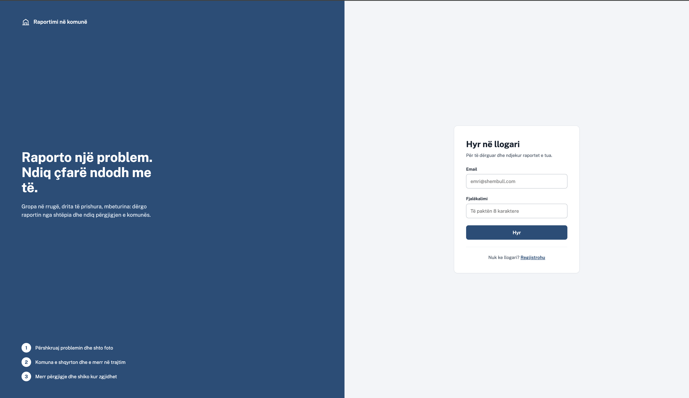
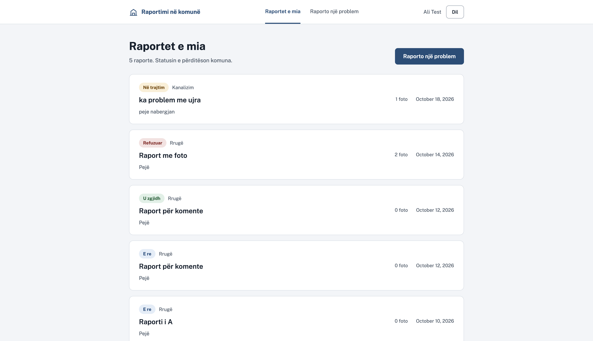
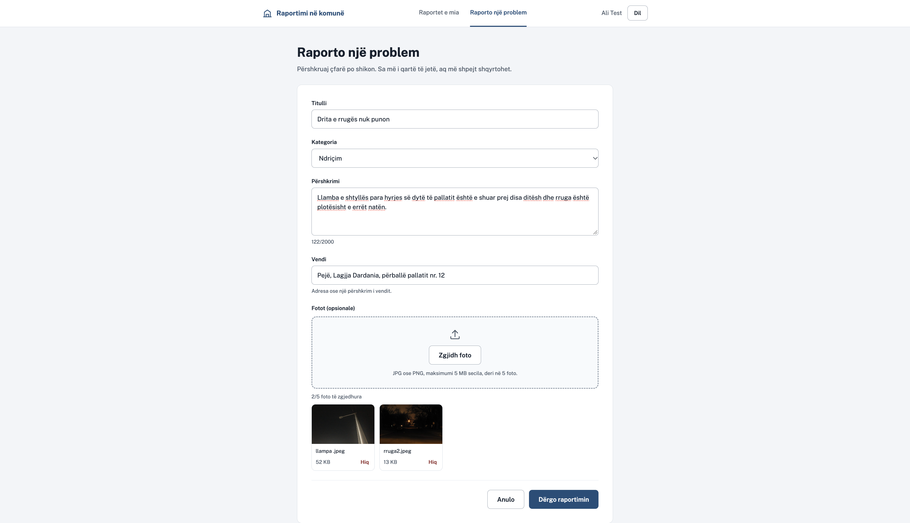
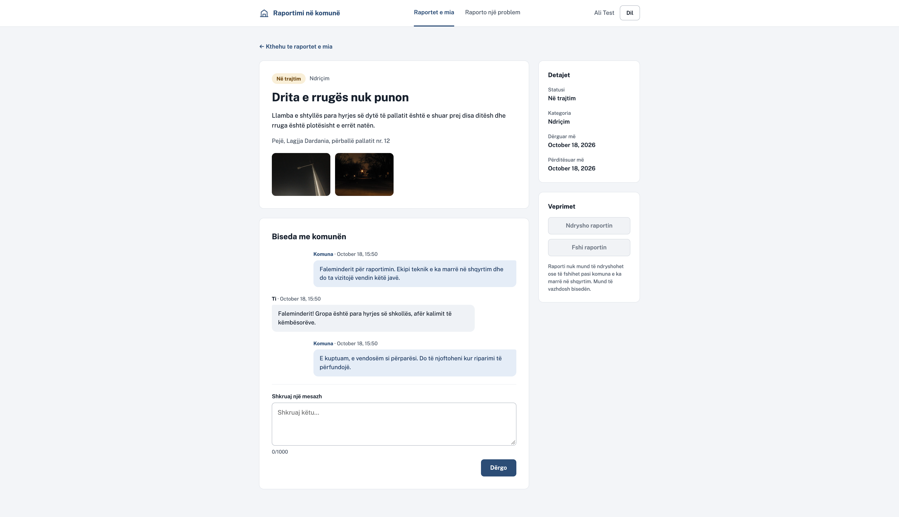
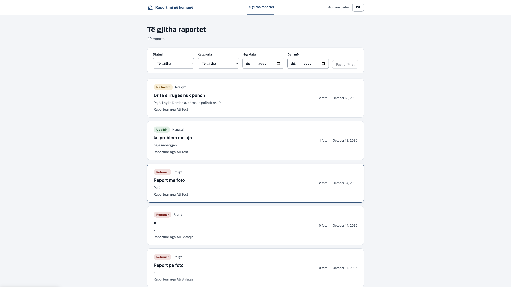
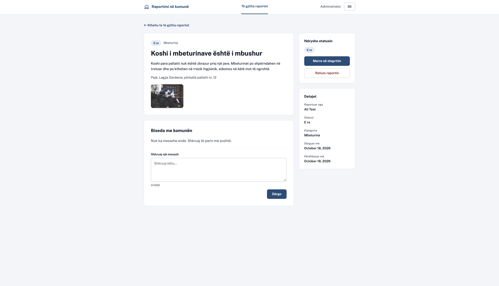

# Sistemi për Raportimin e Problemeve në Komunë

Platformë web ku qytetarët raportojnë probleme (gropa në rrugë, ndriçim, mbeturina etj.)
dhe komuna i shqyrton, u ndryshon statusin dhe u përgjigjet.

## Funksionalitetet
- Regjistrim dhe login (qytetar / admin)
- Krijimi i raportimeve me kategori, lokacion, foto dhe pikë në hartë
- Ndjekja e statusit: New → InProgress → Resolved / Rejected, me historik të ndryshimeve (kush e ndryshoi dhe kur)
- Komente mes komunës dhe qytetarit
- Paneli i adminit për menaxhimin e raportimeve
- Statistika për komunën: totali, sipas statusit, sipas kategorisë dhe sipas muajit, me grafikë
- Pamja: tema e çelët dhe e errët (çelës lart, ruhet te shfletuesi), njoftime të vogla pas veprimeve, skeletone ngarkimi, pult për qytetarin dhe kartë "Kërkon vëmendje" për adminin
- Harta: qytetari zgjedh vendin e problemit në hartë (me klikim ose me vendndodhjen e tij), dhe admini i sheh të gjitha raportet në hartë

## Teknologjitë
- Backend: ASP.NET Core Web API (C#, .NET 10)
- Databaza: PostgreSQL + Entity Framework Core
- Frontend: React 19 + TypeScript, Vite, React Router, ikona Lucide
- Harta: Leaflet (react-leaflet), imazhet satelitore të Esri, pa çelës API
- Autentikimi: JWT

## Pamje të faqeve

### Qytetari
**Hyrja** (`/login`)

**Raportet e mia** (`/raportet`): lista me statusin e secilit raport

**Raporto një problem** (`/raportet/i-ri`): titulli, kategoria, përshkrimi, vendi dhe deri në 5 foto

**Detajet e raportit** (`/raportet/:id`): fotot dhe biseda me komunën

### Admini (komuna)
**Të gjitha raportet** (`/admin/raportet`): lista me filtra sipas statusit, kategorisë dhe datës

**Detajet dhe ndryshimi i statusit** (`/admin/raportet/:id`)

## Databaza

## Si ndizet
Duhet PostgreSQL i instaluar dhe një databazë e quajtur `raportimi_komuna`.
Connection string-u është te `Backend/appsettings.Development.json`.

    cd Backend

### Sekretet (një herë, nuk ruhen në Git)
Sekretet ruhen me `dotnet user-secrets`, jashtë projektit. Pa to aplikacioni nuk niset.

    dotnet user-secrets set "Jwt:Key" "$(openssl rand -base64 48)"
    dotnet user-secrets set "Admin:Email" "admin@komuna.local"
    dotnet user-secrets set "Admin:Password" "<fjalëkalim me të paktën 8 karaktere>"

- `Jwt:Key` është çelësi që nënshkruan tokenat JWT.
- `Admin:Email` dhe `Admin:Password` përdoren për të krijuar adminin në nisjen e parë.

### Nisja

    dotnet ef database update
    dotnet run --launch-profile http

Swagger: http://localhost:5267/swagger

Për endpoint-et e mbrojtura: bëj login te `POST /api/auth/login`, kopjo vetëm tokenin
dhe vendose te butoni **Authorize** i Swagger.

## Si niset frontend-i
Duhet Node.js i instaluar. Backend-i duhet të punojë njëkohësisht (secili në terminalin e vet).

    cd Frontend
    cp .env.example .env
    npm install
    npm run dev

Hapet te http://localhost:5173. Adresa e API-t është te `Frontend/.env` (`VITE_API_URL`);
Vite e lexon `.env` vetëm kur niset, prandaj pas çdo ndryshimi nise sërish.

CORS në backend lejon vetëm `http://localhost:5173` (`Cors:AllowedOrigins` te `Backend/appsettings.json`),
prandaj frontend-i duhet hapur saktësisht në atë adresë.

Kontrollet para commit-it:

    npm run build
    npm run lint

### Faqet e qytetarit
| Rruga | Çfarë bën |
|---|---|
| `/login` | Hyrja |
| `/regjistrohu` | Regjistrimi i qytetarit |
| `/raportet` | Raportet e mia (lista) |
| `/raportet/i-ri` | Forma e raportit të ri, me deri në 5 foto dhe pikë opsionale në hartë (klikim, tërheqje e shenjës, ose "Përdor vendndodhjen time") |
| `/raportet/:id` | Detajet, fotot, harta (kur raporti ka pikë), historiku i statusit dhe biseda me komunën |
| `/raportet/:id/ndrysho` | Ndryshimi i raportit (vetëm kur është `New`) |

Faqet pas hyrjes janë të mbrojtura: pa token të vlefshëm çojnë te `/login`.

### Faqet e adminit (komuna)
Admini hyn me email-in dhe fjalëkalimin e vendosur te `user-secrets` dhe shkon vetë te `/admin/raportet`.
Qytetari nuk i hap këto faqe (ridrejtohet), dhe admini nuk hap faqet e qytetarit.

| Rruga | Çfarë bën |
|---|---|
| `/admin/raportet` | Të gjitha raportet, me filtra: status, kategori, nga data, deri më. Çelës "Listë / Hartë": harta shfaq raportet me pikë, me shenjë në ngjyrën e statusit, grupe kur janë afër njëra-tjetrës dhe një kartë me lidhje te detajet |
| `/admin/raportet/:id` | Raportuesi, përshkrimi, fotot, harta, historiku i statusit, biseda dhe ndryshimi i statusit |
| `/admin/statistika` | Statistikat: katër numra kryesorë, donut sipas statusit, shirita sipas kategorisë, vija e raporteve çdo muaj. Çdo grafik ka edhe pamje si tabelë |

Statusi ndryshon vetëm sipas rrugëve të lejuara: `New` → `InProgress` → `Resolved`, ose `New` → `Rejected`.
Refuzimi kërkon arsye, që qytetari e shikon te biseda si koment.
Çdo ndryshim statusi ruhet te tabela `StatusHistories` dhe shfaqet te detajet si afat kohor ("Historiku i statusit"). Raportet që kanë ndryshuar status para kësaj veçorie nuk kanë histori.

### Hartat
Të gjitha hartat shfaqin vetëm pamjen satelitore (Esri World Imagery me emrat e vendeve). Harta është e kufizuar te Kosova: nuk lëviz dhe nuk zmadhohet mbrapsht përtej saj, gjithçka jashtë kufirit është e errësuar, dhe pika e raportit mund të zgjidhet vetëm brenda Kosovës. Koordinatat ruhen te `Reports` (`Latitude`, `Longitude`), të dyja opsionale; raportet pa pikë nuk shfaqen në hartë, por numërohen poshtë saj. Atribuimi poshtë djathtas është kusht i ofruesve të pllakave dhe nuk hiqet.

**Burimi i kufirit të Kosovës:** [geoBoundaries](https://www.geoboundaries.org) (gbOpen, ADM0, versioni i thjeshtuar), që e merr nga OpenStreetMap (© OpenStreetMap contributors, [openstreetmap.org/copyright](https://www.openstreetmap.org/copyright)); licenca që shënon geoBoundaries është CC BY-SA 2.0. Ruhet te `Frontend/src/data/kosovoBoundary.ts`.

## Endpoint-et deri tani
| Metoda | Rruga | Qasja |
|---|---|---|
| GET | `/api/health` | publike |
| POST | `/api/auth/register` | publike (krijon Citizen) |
| POST | `/api/auth/login` | publike (kthen JWT) |
| GET | `/api/auth/me` | çdo përdorues i loguar |
| GET | `/api/auth/admin-only` | vetëm Admin (endpoint prove) |
| GET | `/api/categories` | publike (lista e kategorive) |
| POST | `/api/reports` | Qytetari (krijon raport me status `New`; `latitude` dhe `longitude` janë opsionale) |
| GET | `/api/reports/my` | Qytetari (një faqe e raporteve të veta). Parametra: `status`, `search`, `sort`, `page`, `pageSize` (shih më poshtë) |
| GET | `/api/reports/{id}` | I zoti ose Admin (të tjerët marrin 404) |
| GET | `/api/reports` | vetëm Admin (një faqe). Parametra: `status`, `categoryId`, `from`, `to`, `search`, `sort`, `page`, `pageSize` (shih më poshtë) |
| GET | `/api/reports/map` | vetëm Admin (pikat për hartën: vetëm raportet me koordinata, me të njëjtat filtra, pa faqosje, deri në 5000) |
| PUT | `/api/reports/{id}` | Qytetari, raportin e vet, vetëm kur është `New` |
| DELETE | `/api/reports/{id}` | Qytetari, raportin e vet, vetëm kur është `New` |
| PATCH | `/api/reports/{id}/status` | vetëm Admin (New → InProgress → Resolved, ose New → Rejected). Fusha `reason` është e detyrueshme për `Rejected`, opsionale për të tjerat, dhe ruhet si koment |
| GET | `/api/reports/stats` | vetëm Admin (vetëm numra: `total`, `byStatus` me të katër statuset, `byCategory` me të gjitha kategoritë, `byMonth` me 6 muajt e fundit; muajt me 0 përfshihen) |
| GET | `/api/reports/{id}/history` | I zoti ose Admin (ndryshimet e statusit nga më i vjetri: nga, te, kush e ndryshoi, kur; lista bosh nëse s'ka ndryshuar ende) |
| GET | `/api/reports/{id}/comments` | I zoti ose Admin (komentet, nga më i vjetri) |
| POST | `/api/reports/{id}/comments` | I zoti ose Admin (edhe kur raporti është i mbyllur) |
| POST | `/api/reports/{id}/images` | Qytetari, raportin e vet, vetëm kur është `New` (`multipart/form-data`, fusha `files`) |
| GET | `/api/reports/{id}/images/{imageId}` | I zoti ose Admin (kthen vetë foton) |
| DELETE | `/api/reports/{id}/images/{imageId}` | Qytetari, raportin e vet, vetëm kur është `New` |

### Listat: faqosja, kërkimi dhe radhitja
`GET /api/reports` dhe `/api/reports/my` kthejnë një faqe, jo të gjitha raportet:

    GET /api/reports?status=New&search=peje&sort=oldest&page=2&pageSize=20

    { "items": [...], "page": 2, "pageSize": 20, "totalCount": 40, "totalPages": 2,
      "statusCounts": [ { "status": "New", "count": 26 }, ... ] }

- `search`: çdo fjalë duhet të gjendet te titulli, përshkrimi, vendi, kategoria ose (vetëm Admin) emri i raportuesit; `peje` gjen edhe "Pejë" (e/ë dhe c/ç quhen të njëjta).
- `sort`: `newest` (paracaktuar), `oldest`, `title`, `status` (sipas rrjedhës, jo alfabetit).
- `pageSize`: 1-100 (paracaktuar 20). `statusCounts` jep sa ka për secilin status sipas filtrave të tjerë (pa statusin), për çipat.
- Numërimi, kërkimi, radhitja dhe faqosja bëhen te databaza.

### Kodet e përgjigjes
- **401**: nuk je i identifikuar (pa token, token i prishur ose i skaduar).
- **403**: je i identifikuar, por roli nuk e lejon veprimin.
- **404**: raporti (ose fotoja) nuk ekziston ose nuk është i yti.
- **409**: veprimi nuk lejohet për gjendjen aktuale të raportit (p.sh. ndryshim kur nuk është `New`).
- **400**: të dhëna të pavlefshme (fushë e munguar, file i pavlefshëm, kufi i kaluar).

Datat e filtrave llogariten sipas UTC. Tokeni vlen 120 minuta.

## Fotot
- Lejohen vetëm `.jpg`, `.jpeg`, `.png`, maksimumi **5 MB** për foto dhe **5 foto** për raport.
- Serveri kontrollon përmbajtjen e vërtetë të file-it (jo vetëm emrin), dhe e ruan me emër të rastësishëm.
- Fotot ruhen si file te `Backend/uploads/` (krijohet vetë në ngarkimin e parë), dhe te databaza ruhet vetëm emri i file-it.
- `Backend/uploads/` është te `.gitignore`: fotot e qytetarëve nuk shkojnë kurrë në Git.
- Fotot shihen vetëm përmes endpoint-it të mbrojtur (kërkon token). Nuk mund të hapen direkt nga shfletuesi pa token.
- Kur fshihet një raport ose një foto, file-t fshihen edhe nga disku.

## Statusi
✅ I përfunduar. Fazat 1-14: backend-i i plotë, frontend-i i qytetarit, paneli i adminit, historiku i statuseve, statistikat për komunën dhe hartat, i lidhur me API-n dhe i provuar.

Ide për më vonë: njoftim me email; hartë e komunave të Kosovës e ngjyrosur sipas numrit të raporteve.
