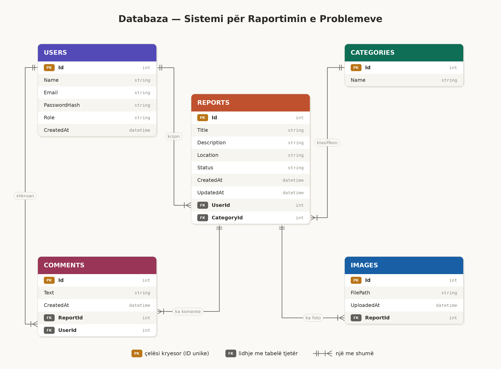

# Sistemi për Raportimin e Problemeve në Komunë

Platformë web ku qytetarët raportojnë probleme (gropa në rrugë, ndriçim, mbeturina etj.)
dhe komuna i shqyrton, u ndryshon statusin dhe u përgjigjet.

## Funksionalitetet
- Regjistrim dhe login (qytetar / admin)
- Krijimi i raportimeve me kategori, lokacion dhe foto
- Ndjekja e statusit: New → InProgress → Resolved / Rejected
- Komente mes komunës dhe qytetarit
- Paneli i adminit për menaxhimin e raportimeve

## Teknologjitë
- Backend: ASP.NET Core Web API (C#, .NET 10)
- Databaza: PostgreSQL + Entity Framework Core
- Frontend: React 19 + TypeScript, Vite, React Router
- Autentikimi: JWT

## Databaza

## Si ndizet
Duhet PostgreSQL i instaluar dhe një databazë e quajtur `raportimi_komuna`.
Connection string-u është te `Backend/appsettings.Development.json`.

    cd Backend

### Sekretet (një herë, nuk ruhen në Git)
Sekretet ruhen me `dotnet user-secrets`, jashtë projektit. Pa to aplikacioni nuk niset.

    dotnet user-secrets set "Jwt:Key" "$(openssl rand -base64 48)"
    dotnet user-secrets set "Admin:Email" "admin@komuna.local"
    dotnet user-secrets set "Admin:Password" "<fjalëkalim me të paktën 8 karaktere>"

- `Jwt:Key` është çelësi që nënshkruan tokenat JWT.
- `Admin:Email` dhe `Admin:Password` përdoren për të krijuar adminin në nisjen e parë.

### Nisja

    dotnet ef database update
    dotnet run --launch-profile http

Swagger: http://localhost:5267/swagger

Për endpoint-et e mbrojtura: bëj login te `POST /api/auth/login`, kopjo vetëm tokenin
dhe vendose te butoni **Authorize** i Swagger.

## Si niset frontend-i
Duhet Node.js i instaluar. Backend-i duhet të punojë njëkohësisht (secili në terminalin e vet).

    cd Frontend
    cp .env.example .env
    npm install
    npm run dev

Hapet te http://localhost:5173. Adresa e API-t është te `Frontend/.env` (`VITE_API_URL`);
Vite e lexon `.env` vetëm kur niset, prandaj pas çdo ndryshimi nise sërish.

CORS në backend lejon vetëm `http://localhost:5173` (`Cors:AllowedOrigins` te `Backend/appsettings.json`),
prandaj frontend-i duhet hapur saktësisht në atë adresë.

Kontrollet para commit-it:

    npm run build
    npm run lint

### Faqet e qytetarit
| Rruga | Çfarë bën |
|---|---|
| `/login` | Hyrja |
| `/regjistrohu` | Regjistrimi i qytetarit |
| `/raportet` | Raportet e mia (lista) |
| `/raportet/i-ri` | Forma e raportit të ri, me deri në 5 foto |
| `/raportet/:id` | Detajet, fotot dhe biseda me komunën |
| `/raportet/:id/ndrysho` | Ndryshimi i raportit (vetëm kur është `New`) |

Faqet pas hyrjes janë të mbrojtura: pa token të vlefshëm çojnë te `/login`.

### Faqet e adminit (komuna)
Admini hyn me email-in dhe fjalëkalimin e vendosur te `user-secrets` dhe shkon vetë te `/admin/raportet`.
Qytetari nuk i hap këto faqe (ridrejtohet), dhe admini nuk hap faqet e qytetarit.

| Rruga | Çfarë bën |
|---|---|
| `/admin/raportet` | Të gjitha raportet, me filtra: status, kategori, nga data, deri më |
| `/admin/raportet/:id` | Raportuesi, përshkrimi, fotot, biseda dhe ndryshimi i statusit |

Statusi ndryshon vetëm sipas rrugëve të lejuara: `New` → `InProgress` → `Resolved`, ose `New` → `Rejected`.
Refuzimi kërkon arsye, që qytetari e shikon te biseda si koment.

## Endpoint-et deri tani
| Metoda | Rruga | Qasja |
|---|---|---|
| GET | `/api/health` | publike |
| POST | `/api/auth/register` | publike (krijon Citizen) |
| POST | `/api/auth/login` | publike (kthen JWT) |
| GET | `/api/auth/me` | çdo përdorues i loguar |
| GET | `/api/auth/admin-only` | vetëm Admin (endpoint prove) |
| GET | `/api/categories` | publike (lista e kategorive) |
| POST | `/api/reports` | Qytetari (krijon raport me status `New`) |
| GET | `/api/reports/my` | Qytetari (raportet e veta) |
| GET | `/api/reports/{id}` | I zoti ose Admin (të tjerët marrin 404) |
| GET | `/api/reports` | vetëm Admin, filtra: `status`, `categoryId`, `from`, `to` |
| PUT | `/api/reports/{id}` | Qytetari, raportin e vet, vetëm kur është `New` |
| DELETE | `/api/reports/{id}` | Qytetari, raportin e vet, vetëm kur është `New` |
| PATCH | `/api/reports/{id}/status` | vetëm Admin (New → InProgress → Resolved, ose New → Rejected). Fusha `reason` është e detyrueshme për `Rejected`, opsionale për të tjerat, dhe ruhet si koment |
| GET | `/api/reports/{id}/comments` | I zoti ose Admin (komentet, nga më i vjetri) |
| POST | `/api/reports/{id}/comments` | I zoti ose Admin (edhe kur raporti është i mbyllur) |
| POST | `/api/reports/{id}/images` | Qytetari, raportin e vet, vetëm kur është `New` (`multipart/form-data`, fusha `files`) |
| GET | `/api/reports/{id}/images/{imageId}` | I zoti ose Admin (kthen vetë foton) |
| DELETE | `/api/reports/{id}/images/{imageId}` | Qytetari, raportin e vet, vetëm kur është `New` |

### Kodet e përgjigjes
- **401**: nuk je i identifikuar (pa token, token i prishur ose i skaduar).
- **403**: je i identifikuar, por roli nuk e lejon veprimin.
- **404**: raporti (ose fotoja) nuk ekziston ose nuk është i yti.
- **409**: veprimi nuk lejohet për gjendjen aktuale të raportit (p.sh. ndryshim kur nuk është `New`).
- **400**: të dhëna të pavlefshme (fushë e munguar, file i pavlefshëm, kufi i kaluar).

Datat e filtrave llogariten sipas UTC. Tokeni vlen 120 minuta.

## Fotot
- Lejohen vetëm `.jpg`, `.jpeg`, `.png`, maksimumi **5 MB** për foto dhe **5 foto** për raport.
- Serveri kontrollon përmbajtjen e vërtetë të file-it (jo vetëm emrin), dhe e ruan me emër të rastësishëm.
- Fotot ruhen si file te `Backend/uploads/` (krijohet vetë në ngarkimin e parë), dhe te databaza ruhet vetëm emri i file-it.
- `Backend/uploads/` është te `.gitignore`: fotot e qytetarëve nuk shkojnë kurrë në Git.
- Fotot shihen vetëm përmes endpoint-it të mbrojtur (kërkon token). Nuk mund të hapen direkt nga shfletuesi pa token.
- Kur fshihet një raport ose një foto, file-t fshihen edhe nga disku.

## Statusi
🚧 Në zhvillim. Përfunduar: Faza 1-7 (backend i plotë) dhe Faza 8-9 (frontend i qytetarit lidhur me API-n: hyrja, regjistrimi, raportet, fotot, biseda, ndryshimi dhe fshirja). Faza 10 (paneli i adminit: lista me filtra, detajet, ndryshimi i statusit, komentet). Tani: Faza 11 (testimi final dhe README i plotë me foto të faqeve).